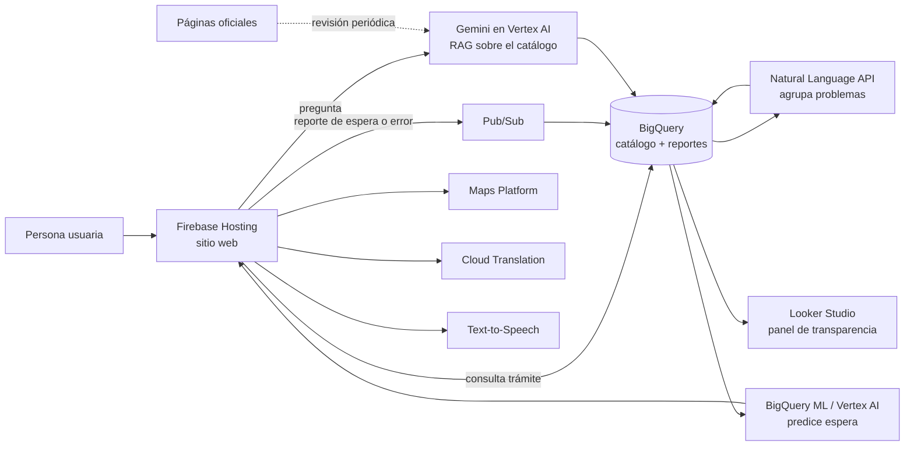

# Cita Clara: cómo está hecho el piloto

**Link público:** https://cita-clara-fd1b4.web.app

## 1. Qué es real y qué es simulado

**Servicios de Google en funcionamiento (3):**
1. **Firebase Hosting**: publica la página.
2. **Firestore**: guarda los reportes ciudadanos ("esperé 1 h", "a mí también me pasó"). Con ellos se calculan la espera, el mejor momento, el orden de los problemas y el panel.
3. **Gemini** (Firebase AI Logic, modelo `gemini-3.5-flash`): responde en el asistente usando solo el catálogo de los 6 trámites.

| Real | De demostración / propuesto |
|---|---|
| Requisitos, pasos, costos y enlaces de los 6 trámites, con fuentes y fecha de consulta (4 nov 2026) | 244 reportes de arranque cargados con `scripts/sembrar_demo.py`, marcados `demo: true`. La página muestra "Incluye reportes de demostración" |
| Direcciones de las sedes y mapa (OpenStreetMap + Leaflet) | Pub/Sub, BigQuery, BigQuery ML, Natural Language, Translation, Text-to-Speech, Maps y Looker Studio: se explican como **arquitectura propuesta** (piden plan con tarjeta) |
| Reportes nuevos guardados en Firestore y recalculados al instante | |
| Asistente con Gemini (si falla, usa respuestas preparadas y lo indica) | |

Las coordenadas del mapa son aproximadas. Algunos datos vienen de notas periodísticas (costos del pasaporte 2026, horarios del INE): revisen las fuentes al final de cada trámite.

### Cómo se calcula la espera (etapa 1 del modelo)
- Se toman los reportes de cada sede de los últimos 90 días.
- Con menos de 3 reportes se muestra **"Sin reportes recientes"** (por ejemplo, el módulo INE 152451).
- Espera = promedio de minutos. Menos de 45 min: poca espera; de 45 a 70: media; 70 o más: mucha.
- Mejor momento = el día y la franja (mañana o tarde) con menor promedio, con al menos 2 reportes.
- En producción, con más datos, esto lo haría un modelo de **BigQuery ML** (etapa 2).

### Seguridad (`firestore.rules`)
- Cualquiera puede leer los reportes (son anónimos y públicos).
- Cualquiera puede crear un reporte, pero solo con los campos y valores permitidos (por ejemplo, minutos solo 15, 45, 90 o 150).
- Nadie puede modificar ni borrar reportes desde la página.
- La clave `apiKey` de `nube.js` es pública por diseño en Firebase; lo que protege los datos son las reglas.

## 2. Archivos

| Archivo | Qué hace |
|---|---|
| `public/index.html` | Esqueleto: franja superior, encabezado, `<main id="app">` donde se dibuja cada pantalla, pie y ventana para reportar la espera. |
| `public/styles.css` | Apariencia institucional, primero para celular. |
| `public/tramite.css` | Estilos de la página del trámite: menú de secciones y apartado "Reportar". |
| `public/datos.js` | Catálogo de los 6 trámites (documentos, pasos, fuentes, problemas conocidos y sedes) y respuestas preparadas de respaldo. |
| `public/nube.js` | **Conexión real**: inicializa Firebase, lee y guarda reportes en Firestore, y conversa con Gemini. |
| `public/app.js` | Pantallas, búsqueda, checklist, mapa, cálculos con los reportes, asistente y panel. |
| `public/logo.svg` | Logo. |
| `firestore.rules` | Reglas de seguridad de la base de datos. |
| `scripts/sembrar_demo.py` | Carga los reportes de demostración. |
| `firebase.json` / `.firebaserc` | Configuración de Firebase (Hosting + reglas) y proyecto `cita-clara-fd1b4`. |

## 3. Funciones importantes de `app.js`

| Función | Para qué sirve |
|---|---|
| `router()` | Lee lo que va después del `#` (por ejemplo `#/tramite/efirma`) y dibuja la pantalla correcta. Así una sola página funciona como varias. |
| `pantallaInicio()` | Buscador, pestañas **Todos / Presencial / En línea** y lista de trámites. |
| `buscarTramites(texto, tipo)` | Filtra por palabra clave (sin importar acentos) y por modalidad. |
| `pantallaTramite(id, extra)` | Página del trámite con menú de secciones (Resumen, Documentos, Paso a paso, Sedes y mapa, Problemas, Fuentes, Reportar). Cada sección tiene su dirección, por ejemplo `#/tramite/efirma/sedes`. Los reportes se leen una vez y se reutilizan. |
| `prepararDatos()` | Junta los cálculos con los reportes: problemas ordenados, sedes con su espera, consejo y la sede con menos espera. |
| `panelReportar()` / `activarPanel()` | Apartado "Reportar" con dos opciones grandes: "Cuánto tiempo esperé" (elige sede y toca un tiempo) y "Tuve un problema" (toca uno conocido o escríbelo). |
| `clasificarProblema()` (nube.js) | **Gemini como clasificador de texto**: decide si lo que escribió la persona es un problema conocido o uno nuevo, le asigna categoría y detecta si trae datos personales (en ese caso el texto no se guarda). |
| `resumirSede()` / `consejoDe()` | Calculan espera promedio, estado y mejor momento a partir de los reportes. |
| `bloqueFuente()` | "¿Es el sitio oficial?": etiqueta oficial gratuito, oficial con costo o no oficial. En "no deudor alimentario" compara las opciones. |
| `bloqueChecklist()` | Documentos marcables con barra de progreso. Se guarda solo en el navegador (`localStorage`). |
| `bloquePasos()` | Ruta numerada con botón directo al sitio oficial. |
| `bloqueSedes()` / `crearMapa()` | Sedes ordenadas por distancia, con su estado de espera y el mapa real. Si una sede no tiene datos dice **"Sin reportes recientes"** en lugar de inventar. |
| `distanciaKm()` | Calcula la distancia entre dos coordenadas (fórmula de Haversine). |
| `leerEnVoz()` | Lee la lista de documentos en voz alta. |
| `pantallaAsistente()` | Envía la pregunta a `nube.preguntarGemini()`. Si Gemini falla, usa `responderChat()` (respuestas preparadas). |
| `preguntarGemini()` (nube.js) | Manda la pregunta a Gemini con instrucciones de usar solo el catálogo y de decir de qué trámite sale la respuesta. |
| `pantallaPanel()` / `htmlBarras()` | Panel calculado con todos los reportes de Firestore. |
| `pantallaAcerca()` | Página "Cómo funciona": de dónde sale la información, límites y tabla de arquitectura. |

## 4. Piloto vs. arquitectura propuesta

| Función | En el piloto | Arquitectura propuesta |
|---|---|---|
| Publicación | **Firebase Hosting** | Firebase Hosting |
| Reportes ciudadanos | **Firestore** | **Pub/Sub** → **BigQuery** |
| Estimación de espera | Promedio de reportes (etapa 1) | **BigQuery ML** / **Vertex AI** (etapa 2) |
| Asistente | **Gemini** con el catálogo en las instrucciones | **Gemini en Vertex AI** con RAG sobre BigQuery |
| Panel | Calculado con Firestore | **Looker Studio** sobre BigQuery |
| Catálogo de trámites | Consultado por el equipo | BigQuery + revisión periódica con Gemini |
| Agrupar problemas | **Gemini** clasifica el texto libre | **Natural Language API** |
| Mapa | OpenStreetMap | **Google Maps Platform** |
| Idiomas y voz | Voz del navegador | **Cloud Translation** y **Text-to-Speech** |

## 5. Arquitectura conceptual



## 6. Cómo actualizar el sitio

Ya está conectado al proyecto `cita-clara-fd1b4` (plan Spark, gratis). Después de cambiar algo, abre una terminal en esta carpeta y ejecuta:

```
firebase deploy
```

(Eso sube la página y las reglas de Firestore.) Para quitar los reportes de demostración: consola de Firebase → Firestore → borrar las colecciones `reportes_espera` y `reportes_error`.

Para probar en tu computadora sin publicar, ejecuta `firebase serve` y abre http://localhost:5000. (Con doble clic al HTML la conexión a Firebase no carga, porque los navegadores bloquean los módulos en archivos locales.)
